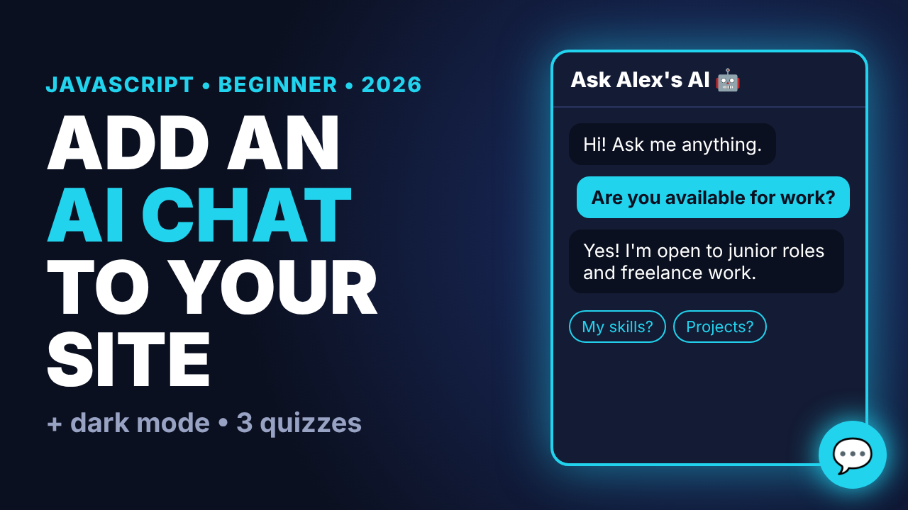

# Part 2: Add an AI Chat Widget + Dark Mode (JavaScript)

Builds on the portfolio from Part 1. Adds:
- Dark / light mode saved with `localStorage`
- A floating chat widget with typing indicator and suggestion chips
- A starter knowledge base you can edit in `script.js`
- `real-ai-example/`: how to connect a real AI model safely (server function, never a key in the browser)

| Path | What it is |
|------|-----------|
| `index.html`, `style.css`, `script.js` | Finished project |
| `starter/` | Part 1 site with CSS variables, ready to follow along |
| `real-ai-example/` | Optional server-side AI example |

Challenge: add a 5th answer to the `answers` array in `script.js`.
